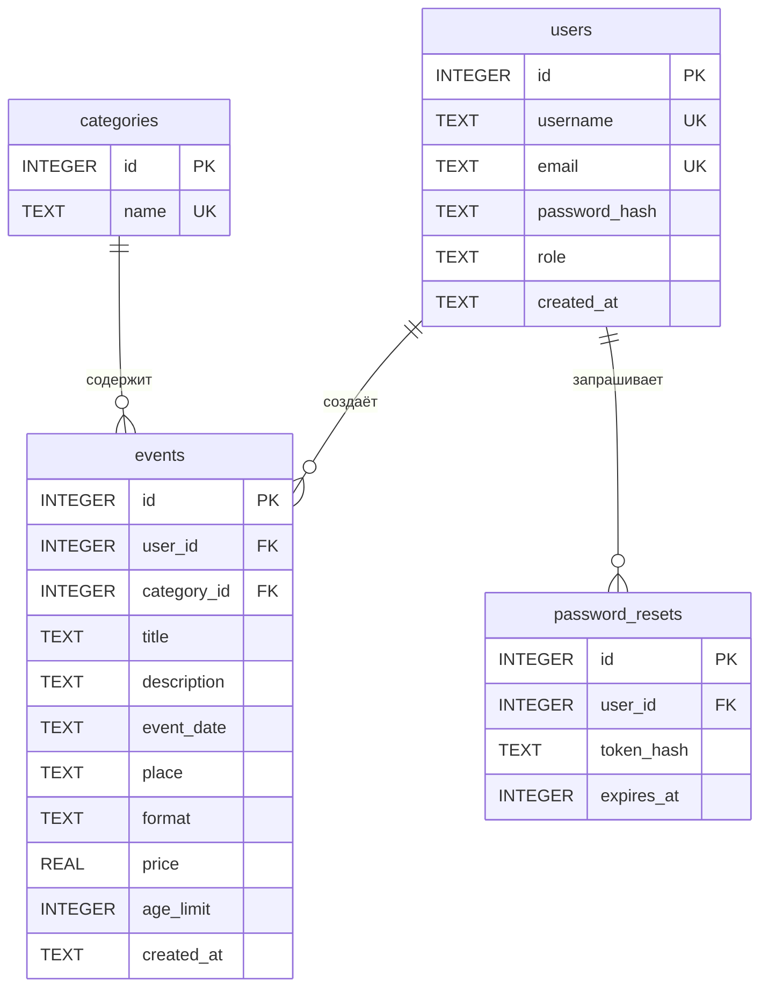

# Афиша мероприятий

Индивидуальная работа по веб-программированию: веб-приложение на PHP с серверной логикой, аутентификацией, ролями и базой данных.

**Автор:** [Корытченко Максим]  **Группа:** [I2502] 

## Содержание

1. [Описание лабораторной работы](#1-описание-лабораторной-работы)
2. [Инструкция по запуску](#2-инструкция-по-запуску)
3. [Документация проекта](#3-документация-проекта)
  - [3.1. Структура проекта](#31-структура-проекта)
  - [3.2. Функциональные возможности](#32-функциональные-возможности)
  - [3.3. Сценарии взаимодействия пользователей с приложением](#33-сценарии-взаимодействия-пользователей-с-приложением)
  - [3.4. Структура базы данных](#34-структура-базы-данных)
  - [3.5. Маршруты приложения](#35-маршруты-приложения)
  - [3.6. Безопасность](#36-безопасность)
4. [Примеры использования](#4-примеры-использования)
5. [Ответы на контрольные вопросы](#5-ответы-на-контрольные-вопросы)
6. [Список использованных источников](#6-список-использованных-источников)
7. [Другие важные аспекты](#7-другие-важные-аспекты)
---

## 1. Описание лабораторной работы

### Цель работы

Разработать веб-приложение средней сложности с функционалом, реализованным на стороне сервера: с регистрацией и входом пользователей, публичным разделом, формами с проверкой данных, защищённым разделом и ролью администратора.

### Задание

Приложение должно содержать:

- регистрацию и вход, пароли хранятся в виде хешей; дополнительно: восстановление пароля;
- общедоступный раздел минимум с 2–3 динамическими элементами из базы данных;
- форму создания ресурса (не менее 5 полей разных типов, проверка на клиенте и на сервере, понятные сообщения об ошибках) и форму поиска;
- защищённый раздел с ролью «администратор» и 3–7 дополнительными функциями (создание администраторов, управление данными в БД);
- защиту от вредоносного ввода, сессии для контроля доступа;
- модульную архитектуру (желательно MVC).
### Тема и технологии

Тема: **афиша мероприятий**. Пользователи публикуют мероприятия (концерты, спектакли, выставки и т. д.), а любой посетитель может искать их без регистрации.

| Часть | Технология |
|---|---|
| Серверная часть | PHP (без фреймворков), PDO |
| База данных | SQLite (один файл, не требует установки сервера) |
| Клиентская часть | HTML, CSS, JavaScript (без библиотек) |
| Архитектура | MVC, единая точка входа |
 
---

## 2. Инструкция по запуску

### Требования

- PHP 7.4 или новее (проверено на 8.3; в коде есть поддержка PHP 8.4+);
- расширения PHP: `pdo_sqlite`, `sqlite3`, `mbstring`;
- папка `database/` должна быть доступна для записи.
### Запуск встроенным сервером PHP

```bash
git clone [ссылка на репозиторий]
cd afisha
php -S localhost:8000 -t public
```

Откройте в браузере: <http://localhost:8000>

База данных `database/afisha.sqlite` **создаётся автоматически** при первом обращении к сайту: создаются таблицы, категории, два пользователя и шесть демонстрационных мероприятий. Чтобы вернуть начальное состояние, остановите сервер и удалите файл `database/afisha.sqlite`.

### Запуск через XAMPP или OpenServer

Скопируйте папку проекта в `htdocs` (или `domains`) и откройте `http://localhost/afisha/public/`.

### Если PHP не находит драйвер SQLite (Windows)

Ошибка `PDOException: could not find driver` означает, что в PHP не включены расширения. Есть два способа:

1. Скопируйте `php.ini-development` в `php.ini` (в папке с `php.exe`) и раскомментируйте (уберите `;` в начале) строки:
```ini
extension_dir = "ext"
extension=mbstring
extension=pdo_sqlite
extension=sqlite3
```
2. Либо включите расширения прямо в команде запуска:
```bash
php -d extension_dir=ext -d extension=mbstring -d extension=pdo_sqlite -d extension=sqlite3 -S localhost:8000 -t public
```
(`extension_dir` нужно указать полным путём к папке `ext` вашего PHP.)

Проверить, что расширения подключены, можно командой `php -m`.

### Тестовые аккаунты

| Роль | Email | Пароль |
|---|---|---|
| Администратор | `admin@example.com` | `admin123` |
| Обычный пользователь | `ivan@example.com` | `ivan12345` |
 
---

## 3. Документация проекта

### 3.1. Структура проекта

```
afisha/
├── public/                  # единственная папка, доступная из браузера
│   ├── index.php            # точка входа и маршрутизация
│   ├── css/style.css        # оформление
│   └── js/validate.js       # клиентская проверка форм
├── app/
│   ├── config.php           # настройки
│   ├── bootstrap.php        # сессия, автозагрузка классов
│   ├── helpers.php          # вспомогательные функции (экранирование, CSRF, вывод страниц)
│   ├── core/
│   │   ├── Database.php     # подключение к SQLite, создание БД при первом запуске
│   │   └── Auth.php         # вход, выход, проверка ролей
│   ├── models/              # Model: работа с базой данных
│   │   ├── User.php
│   │   ├── Event.php
│   │   └── Category.php
│   ├── controllers/         # Controller: логика страниц
│   │   ├── HomeController.php
│   │   ├── AuthController.php
│   │   ├── EventController.php
│   │   └── AdminController.php
│   └── views/               # View: HTML-шаблоны
│       ├── layout/          # шапка и подвал
│       ├── partials/        # карточка мероприятия
│       ├── auth/            # вход, регистрация, восстановление пароля
│       ├── events/          # поиск, форма, таблица мероприятий
│       └── admin/           # страницы администратора
└── database/
    ├── schema.sql           # структура таблиц
    └── afisha.sqlite        # база данных (создаётся автоматически)
```

**Как обрабатывается запрос:** браузер обращается к `public/index.php?page=...`; по таблице маршрутов выбирается метод контроллера; контроллер проверяет права и данные, обращается к моделям (запросы к БД через PDO) и выводит шаблон.

### 3.2. Функциональные возможности

**Для всех посетителей (без входа):**
- главная страница с тремя блоками из БД: ближайшие мероприятия, категории с числом мероприятий, статистика сайта;
- поиск мероприятий по ключевому слову, категории, формату (очно/онлайн), диапазону дат и максимальной цене;
- регистрация, вход, восстановление пароля.
  **Для зарегистрированных пользователей:**
- добавление мероприятия (форма из 8 полей);
- просмотр, редактирование и удаление **своих** мероприятий;
- выход из системы.
  **Для администратора (дополнительно):**
1. панель администратора;
2. просмотр всех мероприятий всех пользователей;
3. редактирование любого мероприятия;
4. удаление любого мероприятия;
5. просмотр списка пользователей;
6. удаление пользователей (кроме себя; мероприятия удалённого пользователя удаляются вместе с ним);
7. создание новых учётных записей с ролью администратора.
   **Форма создания мероприятия** содержит 8 полей:

| Поле | Тип элемента | Правила |
|---|---|---|
| Название | текстовое поле | 3–100 символов |
| Категория | выпадающий список | обязательно, должна существовать |
| Дата и время | `datetime-local` | обязательно, не в прошлом |
| Место проведения | текстовое поле | 2–150 символов |
| Формат | переключатель (radio) | очно или онлайн |
| Цена | число | от 0 до 100000 (0 — бесплатно) |
| Возрастное ограничение | выпадающий список | 0+, 6+, 12+, 16+, 18+ |
| Описание | многострочное поле | 10–2000 символов |

Проверка выполняется дважды: в браузере (`public/js/validate.js`) для быстрой обратной связи и на сервере (`EventController::validate()`) для надёжности. Ошибки показываются красным текстом под соответствующим полем, введённые значения сохраняются.

### 3.3. Сценарии взаимодействия пользователей с приложением

**Сценарий 1. Гость ищет мероприятие**
1. Открывает главную страницу и видит ближайшие мероприятия и категории.
2. Нажимает на категорию или переходит в «Поиск».
3. Задаёт критерии (например, слово «джаз», формат «очно», цена до 200) и нажимает «Найти».
4. Видит карточки подходящих мероприятий или сообщение «По вашему запросу ничего не найдено».
   **Сценарий 2. Регистрация и публикация мероприятия**
1. Гость нажимает «Регистрация», заполняет имя, email, пароль и подтверждение.
2. При ошибках (например, пароли не совпадают) под полями появляются сообщения.
3. После успешной регистрации пользователь автоматически входит в систему.
4. Нажимает «Добавить», заполняет форму мероприятия и отправляет.
5. Мероприятие появляется в разделе «Мои мероприятия» и в публичном поиске.
6. Там же пользователь может изменить или удалить своё мероприятие (с подтверждением удаления).
   **Сценарий 3. Восстановление пароля**
1. На странице входа нажимает «Забыли пароль?» и вводит email.
2. Система создаёт одноразовую ссылку со сроком действия 1 час и «отправляет» её (запись в `database/mail.log`; в демо-режиме ссылка также показывается на странице).
3. Пользователь переходит по ссылке и вводит новый пароль два раза.
4. Пароль меняется, ссылка перестаёт работать, пользователь входит с новым паролем.
   **Сценарий 4. Администратор управляет данными**
1. Входит под учётной записью администратора, в меню появляется «Админ-панель».
2. В «Все мероприятия» видит записи всех авторов, может изменить или удалить любую.
3. В «Пользователи» просматривает список и удаляет ненужных (свою запись удалить нельзя).
4. В «Создать администратора» заводит новую учётную запись с ролью администратора.
   **Сценарий 5. Попытка доступа без прав**
- Гость открывает закрытую страницу и перенаправляется на вход с сообщением.
- Обычный пользователь открывает админ-страницу и получает ошибку 403.
- Пользователь пытается изменить чужое мероприятие и получает ошибку 403.
### 3.4. Структура базы данных

СУБД: SQLite. Файл: `database/afisha.sqlite`. Описание таблиц: `database/schema.sql`.



**users** — учётные записи.

| Поле | Тип | Описание |
|---|---|---|
| id | INTEGER, PK | идентификатор |
| username | TEXT, UNIQUE | имя пользователя |
| email | TEXT, UNIQUE | email (хранится в нижнем регистре), используется для входа |
| password_hash | TEXT | хеш пароля (bcrypt, `$2y$10$...`) |
| role | TEXT | роль: `user` или `admin` |
| created_at | TEXT | дата регистрации |

**categories** — категории мероприятий: `id`, `name` (уникальное).

**events** — мероприятия.

| Поле | Тип | Описание |
|---|---|---|
| id | INTEGER, PK | идентификатор |
| user_id | INTEGER, FK → users | автор; при удалении пользователя мероприятия удаляются (`ON DELETE CASCADE`) |
| category_id | INTEGER, FK → categories | категория |
| title | TEXT | название |
| description | TEXT | описание |
| event_date | TEXT | дата и время в формате `ГГГГ-ММ-ДД ЧЧ:ММ` |
| place | TEXT | место проведения |
| format | TEXT | `offline` или `online` |
| price | REAL | цена, 0 — бесплатно |
| age_limit | INTEGER | возрастное ограничение: 0, 6, 12, 16, 18 |
| created_at | TEXT | дата создания записи |

**password_resets** — токены восстановления пароля.

| Поле | Тип | Описание |
|---|---|---|
| id | INTEGER, PK | идентификатор |
| user_id | INTEGER, FK → users | чей пароль восстанавливается |
| token_hash | TEXT | SHA-256 хеш токена (сам токен в БД не хранится) |
| expires_at | INTEGER | время окончания действия (UNIX-время) |

### 3.5. Маршруты приложения

Все страницы открываются через `public/index.php?page=<имя>`.

| page | Доступ | Назначение |
|---|---|---|
| `home` | все | главная страница |
| `search` | все | поиск мероприятий |
| `register`, `login` | гости | регистрация, вход |
| `logout` | авторизованные (POST) | выход |
| `forgot`, `reset` | все | запрос ссылки и установка нового пароля |
| `my_events` | авторизованные | список своих мероприятий |
| `event_create` | авторизованные | создание мероприятия |
| `event_edit` | автор или администратор | редактирование (`&id=...`) |
| `event_delete` | автор или администратор (POST) | удаление |
| `admin` | администратор | панель администратора |
| `admin_events` | администратор | все мероприятия |
| `admin_users` | администратор | список пользователей |
| `admin_user_delete` | администратор (POST) | удаление пользователя |
| `admin_create` | администратор | создание администратора |

### 3.6. Безопасность

| Угроза | Защита |
|---|---|
| Хранение паролей | `password_hash()` / `password_verify()` (bcrypt с автоматической солью) |
| SQL-инъекции | только подготовленные запросы PDO (`prepare` + `execute`) |
| XSS | весь вывод экранируется функцией `e()` (`htmlspecialchars`) |
| CSRF | скрытый токен в каждой POST-форме, проверка на сервере |
| Обход аутентификации | сессии; проверки `Auth::requireLogin()` и `Auth::requireAdmin()` на сервере; пользователь и его роль читаются из БД при каждом запросе |
| Фиксация сессии | `session_regenerate_id(true)` при входе и выходе; cookie с флагами `httponly`, `samesite` |
| Перебор email | одинаковое сообщение при неверном email и неверном пароле; одинаковый ответ при восстановлении пароля |
| Доступ к чужим данным | проверка владельца мероприятия, иначе ошибка 403 |
| Токены восстановления | случайные (`random_bytes`), в БД хранится только хеш, срок действия 1 час, одноразовые |
| Опасные действия | удаление и выход выполняются только методом POST |
 
---

## 4. Примеры использования

### Скриншоты

> Скриншоты нужно сделать самостоятельно и положить в папку `docs/screenshots/` с указанными именами. Пока файлов нет, изображения ниже не отобразятся.

| Что снять | Файл |
|---|---|
| Главная страница (три блока) | `docs/screenshots/home.png` |
| Форма поиска с результатами | `docs/screenshots/search.png` |
| Регистрация с ошибками валидации | `docs/screenshots/register-errors.png` |
| Форма создания мероприятия (8 полей) | `docs/screenshots/event-form.png` |
| Форма с ошибками под полями | `docs/screenshots/event-form-errors.png` |
| «Мои мероприятия» | `docs/screenshots/my-events.png` |
| Восстановление пароля (демо-ссылка) | `docs/screenshots/password-reset.png` |
| Админ-панель и список пользователей | `docs/screenshots/admin.png` |
| Таблица `users` с хешами паролей (DBeaver) | `docs/screenshots/db-users.png` |


### Примеры запросов поиска

```
index.php?page=search&q=джаз
index.php?page=search&category_id=1&format=offline&price_max=200
index.php?page=search&date_from=2026-12-01&date_to=2026-12-31
```

### Фрагменты кода

**Маршрутизация** (`public/index.php`): единая точка входа выбирает контроллер по параметру `page`.

```php
$page = isset($_GET['page']) && is_string($_GET['page']) ? $_GET['page'] : 'home';
 
if (!isset($routes[$page])) {
    abort(404);
}
 
list($class, $method) = $routes[$page];
(new $class())->$method();
```

**Хеширование пароля** (`app/models/User.php`) и проверка при входе (`app/controllers/AuthController.php`):

```php
// сохранение
$s->execute([$username, $email, password_hash($password, PASSWORD_DEFAULT), $role]);
 
// вход
if ($user && password_verify($password, $user['password_hash'])) {
    Auth::login($user['id']);
}
```

**Подготовленный запрос** (`app/models/Event.php`): значения подставляются отдельно от SQL.

```php
$s = Database::get()->prepare('SELECT * FROM events WHERE user_id = ? ORDER BY event_date');
$s->execute([$userId]);
return $s->fetchAll();
```

**Проверка прав** (`app/core/Auth.php`):

```php
public static function requireAdmin()
{
    self::requireLogin();
    if (!self::isAdmin()) {
        abort(403);
    }
}
```

**Защита от CSRF** (`app/helpers.php`): токен вставляется в каждую форму и сверяется на сервере.

```php
function csrf_check()
{
    $t = $_POST['csrf'] ?? '';
    if (!is_string($t) || !hash_equals(csrf_token(), $t)) {
        abort(400);
    }
}
```

**Клиентская проверка** (`public/js/validate.js`): правила берутся из атрибутов полей.

```html
<input type="password" name="password2" required data-match="password">
<span class="error" data-error-for="password2"></span>
```
 
---

## 5. Ответы на контрольные вопросы

> Вопросы ниже составлены по теме работы. Если в Moodle у вас другие контрольные вопросы, замените их и ответьте по аналогии.

**1. Что такое MVC и как он реализован в проекте?**
MVC делит приложение на три части: *Model* (данные и работа с БД), *View* (представление, HTML) и *Controller* (обработка запроса, связь между ними). В проекте модели лежат в `app/models/` (`User`, `Event`, `Category`), контроллеры в `app/controllers/`, шаблоны в `app/views/`. Запрос попадает в `public/index.php`, затем в метод контроллера, который обращается к моделям и выводит шаблон. Благодаря разделению SQL-запросы находятся только в моделях, а HTML только в шаблонах.

**2. Как хранятся пароли и зачем нужен хеш?**
Пароли сохраняются в виде хеша функцией `password_hash()` (bcrypt) в поле `users.password_hash`. Хеш односторонний: по нему нельзя восстановить пароль, поэтому при утечке базы пароли не раскрываются напрямую. bcrypt автоматически добавляет случайную соль, поэтому одинаковые пароли дают разные хеши. При входе вызывается `password_verify()`, которая сравнивает введённый пароль с хешем.

**3. Что такое SQL-инъекция и как от неё защищено приложение?**
Это внедрение SQL-кода через данные пользователя (например, `' OR 1=1 --` в поле поиска). Защита: подготовленные запросы PDO. Текст запроса и значения передаются отдельно (`prepare()` и `execute([...])`), поэтому введённая строка всегда трактуется как данные, а не как команда.

**4. Что такое XSS и как приложение от него защищено?**
XSS — внедрение вредоносного JavaScript в страницу, например через название мероприятия `<script>...</script>`. Защита: весь пользовательский вывод проходит через `htmlspecialchars()` (функция `e()`), поэтому символы `<`, `>` и кавычки превращаются в безопасные сущности и браузер показывает их как текст.

**5. Что такое CSRF и как от него защищаются?**
CSRF — подделка запроса: вредоносный сайт заставляет браузер авторизованного пользователя отправить запрос на наш сайт (например, на удаление). Защита: в каждой POST-форме есть скрытый случайный токен, привязанный к сессии. Сервер сравнивает его с сохранённым (`csrf_check()`), и запрос без верного токена отклоняется (ошибка 400). Кроме того, опасные действия выполняются только методом POST, а cookie сессии имеет флаг `samesite`.

**6. Как работают сессии и аутентификация?**
После успешного входа в `$_SESSION['user_id']` записывается идентификатор пользователя, а браузеру выдаётся cookie с идентификатором сессии. При каждом запросе `Auth::user()` по этому идентификатору читает пользователя из БД, поэтому роль и существование пользователя всегда актуальны. При входе вызывается `session_regenerate_id(true)`, чтобы защититься от фиксации сессии.

**7. Зачем проверять данные и на клиенте, и на сервере?**
Проверка в браузере (JavaScript и атрибуты HTML) даёт мгновенную подсказку и экономит запросы, но её легко обойти (отключить JS, отправить запрос напрямую). Поэтому серверная проверка обязательна: только она гарантирует корректные данные в БД. В проекте правила совпадают, а сообщения выводятся в одно и то же место под полем.

**8. Как реализовано разграничение прав (роли)?**
В таблице `users` есть поле `role` (`user` или `admin`). Закрытые действия начинаются с `Auth::requireLogin()`, админские — с `Auth::requireAdmin()` (вызывается в конструкторе `AdminController`). Для мероприятий дополнительно проверяется владелец: изменять чужое может только администратор, иначе ошибка 403. Скрытие кнопок в меню лишь удобство, настоящая защита выполняется на сервере.

**9. Как безопасно реализовано восстановление пароля?**
Пользователь вводит email, создаётся случайный токен (`random_bytes`), в БД сохраняется только его SHA-256 хеш и срок действия (1 час). Ссылка с токеном отправляется на почту. По ссылке пользователь задаёт новый пароль, после чего все токены удаляются, и ссылка перестаёт работать. Ответ на запрос одинаков для существующего и несуществующего email, чтобы нельзя было узнать, кто зарегистрирован.

**10. В чём разница между методами GET и POST и где они применяются в проекте?**
GET передаёт параметры в адресе и подходит для получения данных, которые безопасно повторять, например поиск (`?q=джаз`), так что результат можно сохранить в закладки. POST передаёт данные в теле запроса и используется для действий, меняющих состояние: регистрация, вход, создание, изменение, удаление, выход.

**11. Что такое PDO и в чём его преимущества?**
PDO — встроенный в PHP единый интерфейс для работы с разными СУБД. Он поддерживает подготовленные запросы (защита от SQL-инъекций), исключения при ошибках и позволяет сменить СУБД (например, SQLite на MySQL), изменив в основном строку подключения.
 
---

## 6. Список использованных источников

1. PHP: Руководство по PHP. — URL: <https://www.php.net/manual/ru/>
2. PHP: PDO — Руководство по PHP. — URL: <https://www.php.net/manual/ru/book.pdo.php>
3. PHP: password_hash — Руководство по PHP. — URL: <https://www.php.net/manual/ru/function.password-hash.php>
4. PHP: Сессии — Руководство по PHP. — URL: <https://www.php.net/manual/ru/book.session.php>
5. SQLite Documentation. — URL: <https://www.sqlite.org/docs.html>
6. OWASP Cheat Sheet Series (CSRF Prevention, Password Storage, Forgot Password, SQL Injection Prevention, XSS Prevention). — URL: <https://cheatsheetseries.owasp.org/>
7. MDN Web Docs: Валидация форм на стороне клиента. — URL: <https://developer.mozilla.org/ru/>
8. phpDocumentor: Документация по PHPDoc. — URL: <https://docs.phpdoc.org/>
9. Материалы курса и методические указания в Moodle.
10. Google Gemini - помошник в написании кода
11. Claude code - помошник в написании кода
12. DeepSeek - помошник в написании отчетов
---

## 7. Другие важные аспекты

**Что намеренно не реализовано** (так как не требуется заданием): CAPTCHA, пагинация, загрузка изображений, подтверждение email при регистрации, расширение приложения под большую нагрузку.

**Демо-режим восстановления пароля.** На локальном сервере почта обычно не настроена, поэтому письма записываются в `database/mail.log`, а ссылка дополнительно показывается на странице. Для «боевого» режима в `app/config.php` нужно поставить `'show_reset_link' => false` и настроить отправку почты на сервере.

**Файлы, которые не нужно добавлять в репозиторий.** База данных и лог писем создаются автоматически, поэтому добавьте в `.gitignore`:

```
database/afisha.sqlite
database/mail.log
```

**Защита файлов при запуске на Apache.** В папках `app/` и `database/` лежат файлы `.htaccess` (`Require all denied`), закрывающие их от прямого доступа из браузера. При запуске встроенным сервером с параметром `-t public` эти папки и так недоступны.

**Ограничения.** Приложение учебное. SQLite подходит для небольшой нагрузки; при переходе на MySQL нужно изменить подключение в `app/core/Database.php` и несколько особенностей SQL (например, поиск без учёта регистра).
 
